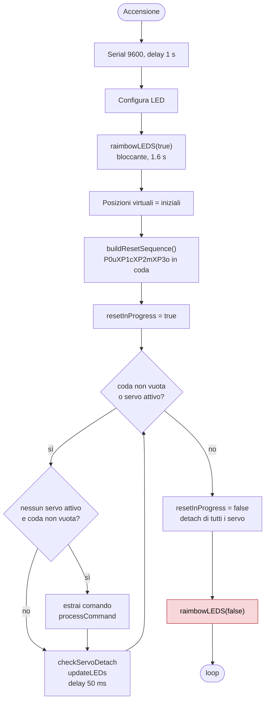
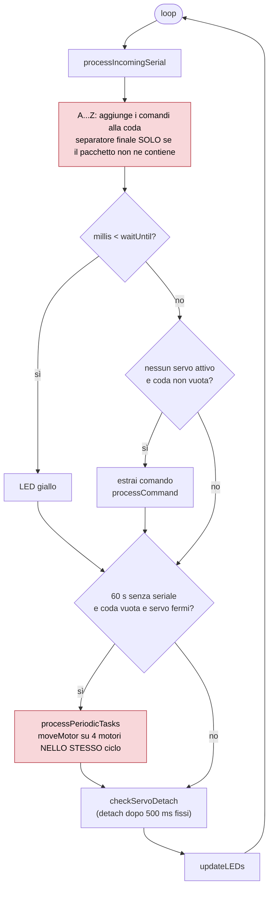
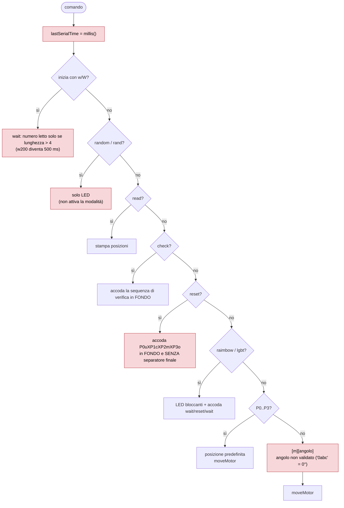
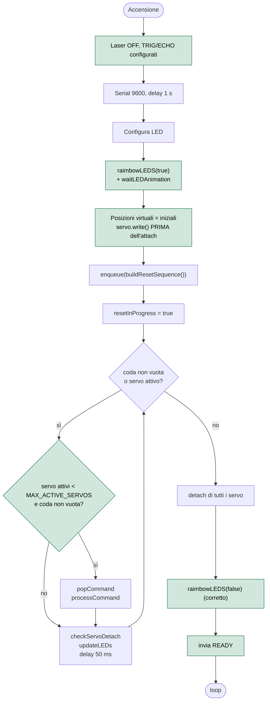
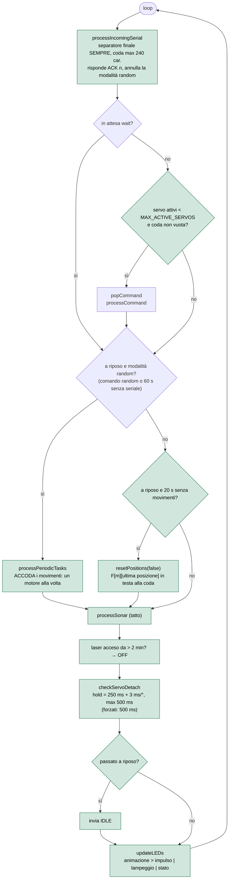
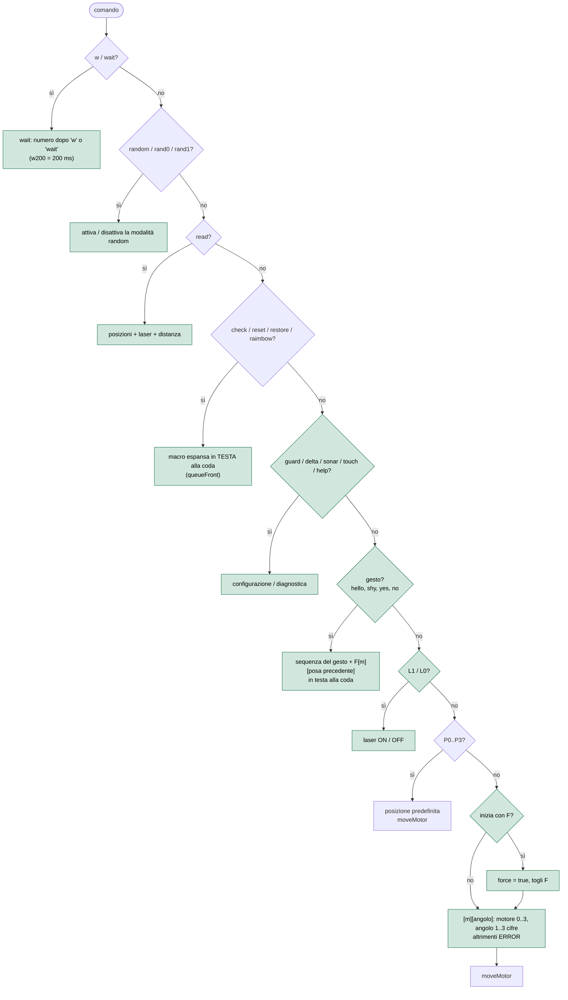
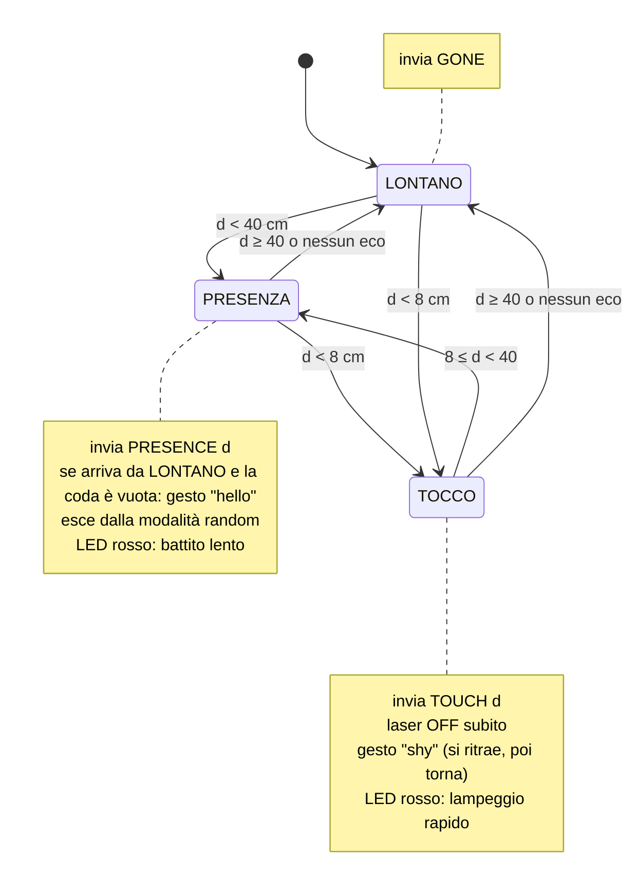
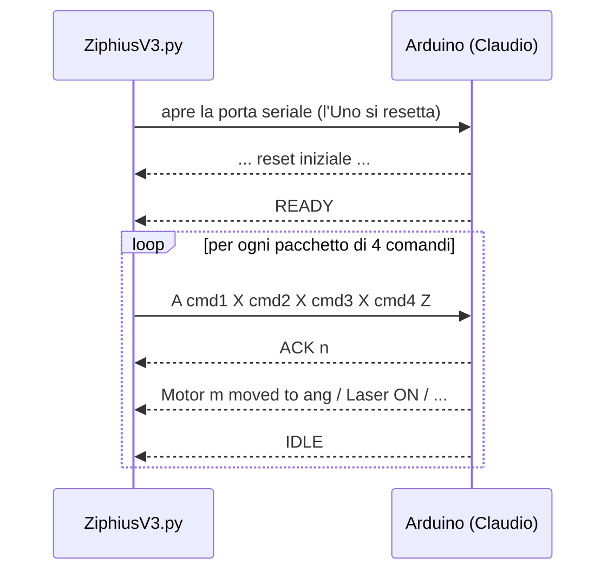

# Claudio — diagrammi di flusso

I diagrammi sono in Mermaid: GitHub li disegna direttamente.

- [1. Firmware vecchio (V33V6.1)](#1-firmware-vecchio-v33v61)
- [2. Firmware nuovo](#2-firmware-nuovo)
- [3. Tatto (HC-SR04)](#3-tatto-hc-sr04)
- [4. Python ↔ Arduino: controllo di flusso](#4-python--arduino-controllo-di-flusso)

---

## 1. Firmware vecchio (V33V6.1)

I nodi rossi indicano i difetti corretti nella versione nuova.

### setup()

`raimbowLEDS(false)` non accende nulla: il ciclo `for (i = N-1; i > N; i--)` non entra mai.

### loop()

### processCommand()

Conseguenze dei difetti principali:

| Difetto | Effetto |
|---|---|
| Separatore finale mancante | Python invia 4 comandi per pacchetto; l'ultimo (`1050`) si fonde con il primo del pacchetto successivo (`0090`) e diventa `10500090`: M1 va a 180°. |
| Random su 4 motori insieme | Viola "un motore alla volta": fino a ~3 A richiesti alla USB, con rischio di reset dell'Uno. |
| `reset` in fondo alla coda | Nel `check` il reset iniziale viene eseguito alla fine della sequenza. |
| `lastSerialTime` in `processCommand` | Se i comandi interni passano dalla coda, la modalità random si riattiva una sola volta. |

---

## 2. Firmware nuovo

I nodi verdi sono nuovi o modificati.

### setup()

### loop()

### processCommand()

---

## 3. Tatto (HC-SR04)

Una misura ogni 100 ms. La zona cambia dopo 3 misure concordi, e tra due reazioni passano almeno 4 s.

---

## 4. Python ↔ Arduino: controllo di flusso

Il pacchetto successivo parte solo dopo `IDLE`, cioè quando la coda è vuota e i servo sono staccati. Prima Python inviava a tempo fisso e leggeva una sola riga di risposta: le risposte si accumulavano e i comandi si fondevano.
