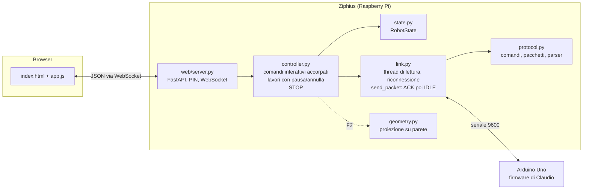
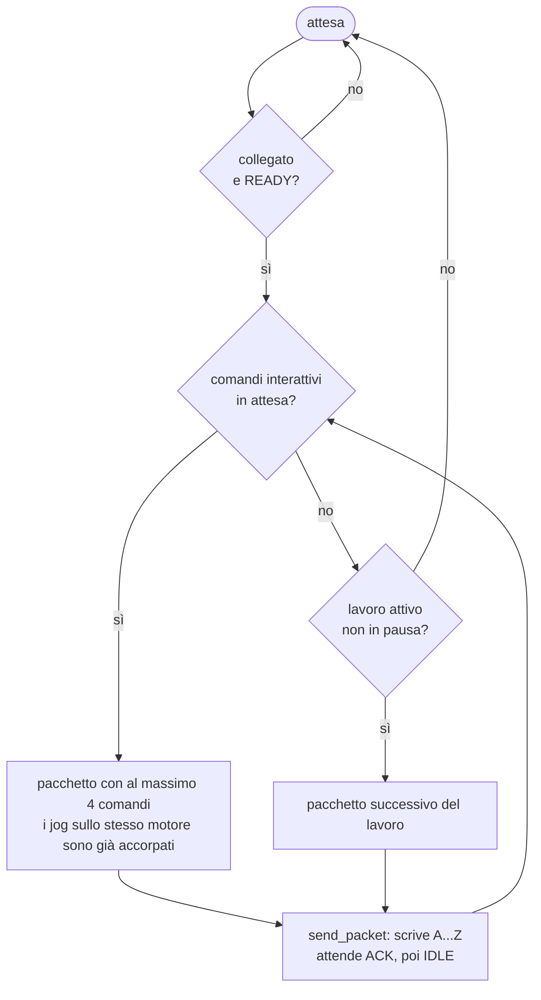

# Ziphius V4

Ziphius V4 controlla Claudio da Raspberry Pi o PC, tramite una pagina web raggiungibile in LAN e protetta da PIN. `ZiphiusV3.py` resta disponibile e invariato.

## Stato delle fasi

| Fase | Contenuto | Stato |
|---|---|---|
| F1 | Nucleo (seriale asincrona, eventi, geometria) + pagina web con controllo interattivo e PIN | **fatta** |
| F2 | Forme (testo Hershey, SVG, figure base, curve parametriche), disegno e anteprima da web | da fare |
| F3 | Regole evento → azione configurabili da web (es. TOUCH durante un disegno) | da fare |
| F4 | Servizio systemd sul Raspberry + firmware in microsecondi (passo di circa 0,5°) | da fare |

## Avvio

```
pip install -r requirements.txt
python -m ziphius ports                 # porte seriali trovate (Raspberry: /dev/ttyACM0)
python -m ziphius serve                 # http://<ip-del-raspberry>:8042
python -m ziphius pin                   # mostra il PIN (generato al primo avvio)
python -m ziphius pin 482913            # cambia il PIN
python -m ziphius send "P1lXw500XP1cXhello"
```

Su Raspberry Pi OS Bookworm, pip richiede un ambiente virtuale: `python3 -m venv ~/ziphius-venv && ~/ziphius-venv/bin/pip install -r requirements.txt`. L'utente deve appartenere al gruppo `dialout` per usare la seriale: `sudo usermod -aG dialout $USER`.

La configurazione si trova in `~/.config/ziphius/config.json`, oppure nel file indicato da `$ZIPHIUS_CONFIG`. Contiene porta, PIN, pose salvate e geometria della parete. Se nella cartella corrente c'è `claudio_wall.json` della V3, la calibrazione viene importata.

## Pagina web

- **Motori:** cursori (il comando parte al rilascio) e pulsanti ±1°/±5°.
- **Tastiera:** ←/→ corpo, ↑/↓ laser, W/S braccio, Q/E pinza, Maiusc per passi da 5°, Spazio per il laser, Esc per lo STOP.
- **Laser e gesti:** `hello`, `shy`, `yes`, `no`.
- **Comportamento:** modalità random, ritorno in posizione, tatto.
- **Pose:** salvataggio, richiamo ed eliminazione.
- **Console:** comandi grezzi con la sintassi del firmware, elenco dei lavori (pausa, ripresa, annullamento) e registro delle comunicazioni.
- **STOP:** invia `AstopZ`, che il firmware esegue subito senza passare dalla coda. Svuota la coda, spegne il laser e annulla wait e random.

Il PIN viene confrontato in tempo costante. Dopo 5 tentativi errati dallo stesso indirizzo l'accesso si blocca per 60 s. La sessione è un cookie HttpOnly con SameSite=Strict. In LAN il traffico è HTTP in chiaro: il PIN ferma gli accessi casuali, non chi intercetta la rete.

## Architettura



### Priorità di invio



Se si tiene premuta una freccia mentre Claudio si muove, i jog si sommano sul bersaglio di quel motore. Al successivo `IDLE` parte un solo movimento verso il bersaglio aggiornato, quindi non si accumula ritardo.

## Test

```
python -m pytest -q
```

`tests/fake_arduino.py` imita le risposte del firmware. I test coprono il protocollo, lo stato, la geometria, l'accorpamento dei jog, il controllo di flusso, pausa, STOP, riconnessione, pose, login con blocco e WebSocket.
